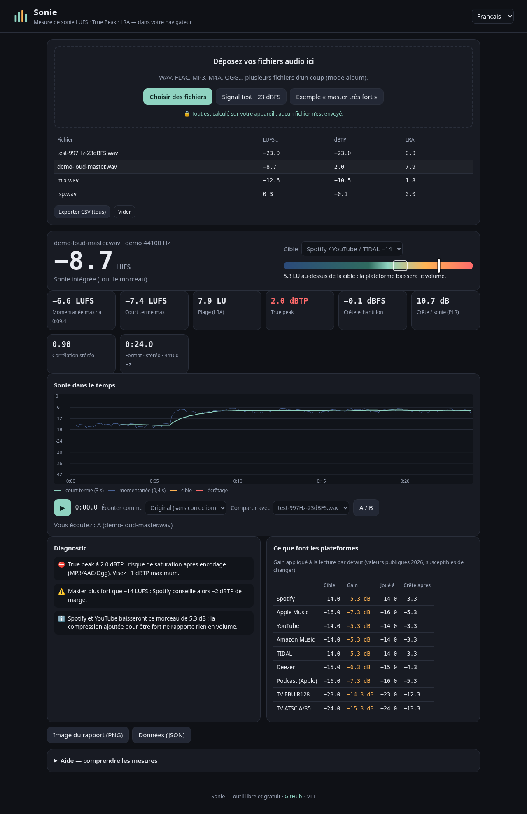

# Sonie — mesure de loudness LUFS / True Peak dans le navigateur

**Démo : https://salimadour31-boop.github.io/sonie-atelier/**

🇫🇷 Sonie mesure la **sonie** de vos morceaux (LUFS intégré, true peak, LRA…) et montre **ce que Spotify, Apple Music, YouTube, TIDAL, Deezer ou la TV en feront**. Tout est calculé **sur votre appareil** : aucun fichier n'est envoyé, pas de compte, pas d'installation.
🇬🇧 Sonie measures your tracks' **loudness** (integrated LUFS, true peak, LRA…) and shows **what streaming platforms and TV will do to them**. Everything runs **locally**: no upload, no account, no install.
ⵣ Interface en Taqbaylit (Kabyle, caractères latins) également.

## Pourquoi / Why

« Mon master est-il prêt pour Spotify ? », « pourquoi mon morceau sonne plus faible une fois en ligne ? » : ces questions reviennent sans cesse chez les musiciens et monteurs (r/WeAreTheMusicMakers, r/audioengineering, r/editors). Les outils qui y répondent sont souvent payants ou envoient vos fichiers sur un serveur. Sonie est libre (MIT) et 100 % local.

## Fonctions / Features

- **Mesures ITU-R BS.1770-4 / EBU R128** : sonie intégrée (portes −70 LUFS et −10 LU), momentanée (400 ms) et court terme (3 s) max, **LRA** (EBU Tech 3342), **true peak** (suréchantillonnage ×4), crête échantillon, **PLR**, corrélation stéréo, décalage DC, zones d'écrêtage avec leurs horodatages.
- **Mode album** : déposez plusieurs fichiers, tableau comparatif, **export CSV**.
- **Plateformes** : gain appliqué par Spotify, Apple Music, YouTube, Amazon Music, TIDAL, Deezer, podcast, EBU R128 et ATSC A/85, niveau joué et crête après correction (les plateformes qui ne remontent pas le volume, ou seulement jusqu'à −1 dBTP, sont prises en compte).
- **Écouter comme une plateforme** : lecture avec le gain de Spotify, Apple Music… appliqué.
- **A/B au même niveau** : comparez votre master à une référence **à sonie égale** (le plus fort ne gagne plus par effet de volume).
- **Courbe dans le temps** (court terme, momentanée, cible, écrêtages) ; cliquez pour vous déplacer.
- **Diagnostic en clair** : true peak trop haut, master écrasé, opposition de phase, DC, écrêtage, gain perdu sur les plateformes.
- **Exports** : image du rapport (PNG), données (JSON avec les courbes), CSV de tous les fichiers.
- WAV lus **sans rééchantillonnage** (8/16/24/32 bits, flottant 32/64) ; MP3, FLAC, M4A, OGG… via le décodeur du navigateur.
- Signaux de démo générés (tonalité de test, « master très fort ») : aucun fichier audio externe.
- Mesure dans un **Web Worker** (l'interface reste fluide), responsive mobile, FR / EN / Taqbaylit.

## Utilisation / Usage

1. Ouvrez la démo (ou `index.html` via un petit serveur local : `python3 -m http.server`).
2. Déposez un ou plusieurs fichiers audio, ou essayez un signal de démo.
3. Lisez la sonie intégrée, le diagnostic et le tableau des plateformes ; écoutez « comme Spotify », comparez en A/B avec une référence, exportez le rapport.

> −14 LUFS n'est pas une obligation : c'est le niveau de **lecture** de Spotify. Masterisez pour le son voulu, gardez le true peak sous −1 dBTP (−2 dBTP si le master est plus fort que −14 LUFS).

## Précision et tests

`npm test` (ou `node tests/loudness.test.js && node tests/wav.test.js`) vérifie, à partir des normes :
- les coefficients de pondération K à 48 kHz (table BS.1770) ;
- tonalité 1 kHz stéréo à −23 dBFS → **−23,0 LUFS** à 44,1 / 48 / 96 kHz (EBU Tech 3341) ;
- portes absolue et relative, LRA ≈ 10 LU pour deux blocs à 10 dB d'écart, true peak d'une sinusoïde fs/4 déphasée de 45° (crête échantillon −3 dB, true peak ≈ 0 dBTP) ;
- écrêtage, DC, opposition de phase, gains des plateformes, lecteur WAV 16/24 bits et flottant.

Recoupement avec le filtre `ebur128` de FFmpeg sur des fichiers de test : sonie intégrée, LRA et crêtes identiques au dixième.

## Limites

- Les cibles des plateformes sont des valeurs publiques (2026) qui peuvent changer ; c'est une **estimation** du réglage par défaut (normalisation par album, réglages utilisateur et codecs non simulés).
- Formats autres que WAV : décodés par le navigateur, donc rééchantillonnés à la fréquence de la carte son (sonie inchangée, true peak légèrement différent). AIFF/FLAC selon le navigateur.
- Mono mesuré selon BS.1770 (un seul canal) ; 5.1 pondéré, autres multicanaux pondérés à 1.
- Pas un appareil de mesure certifié pour la diffusion.

## Licence

MIT — code original, aucune dépendance, polices système. Mesures écrites d'après les spécifications publiques ITU-R BS.1770-4, EBU R128, EBU Tech 3341/3342.
